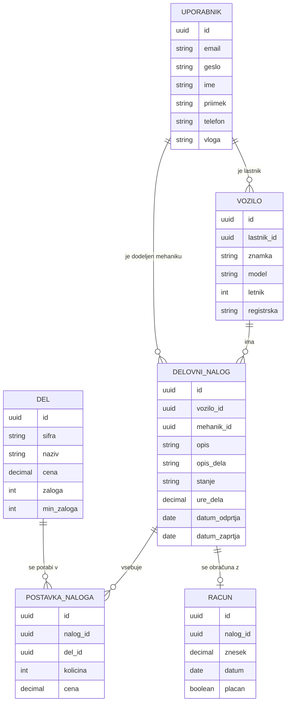

# 03 Podatkovni model

Baza: CockroachDB

## Entitete

**Uporabnik**: id, email, geslo (BCrypt), ime, priimek, telefon, vloga (`MEHANIK` | `STRANKA` | `VODJA`).

**Vozilo**: id, lastnik_id, znamka, model, letnik, registrska

**Del**: id, sifra, naziv, cena, zaloga, min_zaloga

**DelovniNalog**: id, vozilo_id, mehanik_id (uporabnik z vlogo `MEHANIK`), opis (težava), opis_dela, stanje (`ODPRT` | `V_DELU` | `ZAKLJUCEN` | `OBRACUNAN`), ure_dela, datum_odprtja, datum_zaprtja

**PostavkaNaloga**: id, nalog_id, del_id, kolicina, cena (cena dela ob dodajanju)

**Racun**: id, nalog_id, znesek, datum, placan

## Povezave

- Uporabnik (stranka) 1 : N Vozilo
- Vozilo 1 : N DelovniNalog
- Uporabnik (mehanik) 1 : N DelovniNalog
- DelovniNalog 1 : N PostavkaNaloga
- Del 1 : N PostavkaNaloga
- DelovniNalog 1 : 0..1 Racun
- Del 1 : N Narocilo

## Diagram

- Račun = vsota (količina × cena) vseh postavk + ure dela × urna postavka. Stranka z vsaj 4 prejšnjimi računi dobi 10 % popusta
- Cena je shranjena tudi v postavki, da poznejša sprememba cene dela ne spremeni starih računov.
- Naročilo je simulirano.