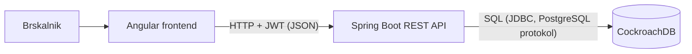

# 04 Arhitektura in tehnološki sklad

## Arhitektura

Tri plasti: spletni odjemalec, REST zaledje in baza.

### Glavni deli

- **Frontend (Angular):** prikaz strani, obrazci, klici REST API-ja. Žeton hrani v brskalniku in ga pošilja v glavi `Authorization`.
- **Backend (Spring Boot):** REST API, poslovna pravila (stanja nalogov, odpis zaloge, obračun), preverjanje vlog.
- **Baza (CockroachDB):** trajna shramba vseh entitet

### Komunikacija

Frontend pošilja JSON prek HTTP na backend. Backend se na bazo povezuje prek JDBC. Frontend z bazo ne komunicira direkt.

### Avtentikacija

- Prijava: `POST /api/prijava` (email, geslo) vrne JWT z ID-jem uporabnika in vlogo.
- Gesla so shranjena kot BCrypt hashi.
- Backend pri vsaki zahtevi preveri žeton in vlogo (Spring Security). Stranka vidi samo svoje podatke.

## Tech stack

| Del | Tehnologija |
|---|---|
| Frontend | Angular |
| Backend | Java, Spring Boot, springdoc (Swagger/OpenAPI) |
| Baza | CockroachDB (lokalno, Docker) |
| Avtentikacija | Spring Security + JWT, BCrypt |
| Pregled baze | DBeaver |

## Arhitekturne odločitve

- **Spring Boot:** Znano orodje, malo konfiguracije, vgrajena podpora za REST, bazo in Swagger.
- **CockroachDB:** Relacijska baza,  PostgreSQL protokol. Lokalno jo zaženemo v Dockerju. Podatki so povezani (nalogi, postavke, računi), zato relacijska baza ustreza.
- **Preprost JWT:** Zaradi enostavne prijave in shranjevanja vloge v žetonu. Backend ne hrani sej.
- **En backend namesto mikrostoritev:** Aplikacija je majhna, en projekt je lažje vzdrževati.
- **Plasti na backendu:** Poslovna pravila so na enem mestu v servicih, kontrolerji samo sprejmejo zahtevo.
- **Docker in docker-compose:** Baza in aplikacija se zaženeta enako na vsakem računalniku.
- **Angular:** Aplikacija je razdeljena na komponente in servise. Komponenta prikaže stran, API servis kliče backend. TypeScript sproti opozori na napake v tipih.
- **Git:** Hrani zgodovino sprememb, za lažjo povrnitev stanja v primeru napak