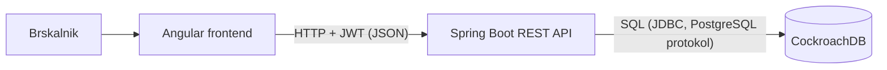

# 04 Arhitektura in tehnološki sklad

## Arhitektura

Tri plasti: spletni odjemalec, REST zaledje in baza.

### Glavni deli

- **Frontend (Angular):** prikaz strani, obrazci, klici REST API-ja. Žeton hrani v brskalniku in ga pošilja v glavi `Authorization`.
- **Backend (Spring Boot):** REST API, poslovna pravila (stanja nalogov, odpis zaloge, obračun), preverjanje vlog.
- **Baza (CockroachDB):** trajna shramba vseh entitet iz dokumenta 03.

### Komunikacija

Frontend pošilja JSON prek HTTP na backend. Backend se na bazo povezuje prek JDBC (PostgreSQL gonilnik). Frontend z bazo ne komunicira neposredno.

### Avtentikacija

- Prijava: `POST /api/prijava` (email, geslo) vrne JWT z ID-jem uporabnika in vlogo.
- Gesla so shranjena kot BCrypt zgoščena vrednost.
- Backend pri vsaki zahtevi preveri žeton in vlogo (Spring Security). Stranka vidi samo svoje podatke.
- Žeton ima samo en tip (brez osveževalnih žetonov), da ostane rešitev preprosta.

### Lokalni zagon

- `docker compose up` zažene bazo in backend (backend na vratih 8080, baza na 26257, konzola baze na 8081).
- Frontend: `ng serve` (vrata 4200) med razvojem.
- Podatke napolni skripta za polnjenje (Faker), ki jo poženemo enkrat po zagonu baze.

## Tehnološki sklad

| Del | Tehnologija |
|---|---|
| Frontend | Angular |
| Backend | Java, Spring Boot (Web, Data JPA, Security), springdoc (Swagger/OpenAPI) |
| Baza | CockroachDB (lokalno, Docker) |
| Avtentikacija | Spring Security + JWT, BCrypt |
| Lokalni razvoj | Docker, Docker Compose, Git, Maven |
| Polnjenje podatkov | Python skripta s knjižnico Faker (približno 10.000 zapisov) |
| Pregled baze | DBeaver (ali DB Console v brskalniku) |

## Arhitekturne odločitve

- **Ločen frontend in backend:** zahteva PTS vaje, hkrati omogoča, da isti REST API služi tudi za SOA demonstracijo.
- **Spring Boot:** standarden, malo konfiguracije, vgrajena podpora za REST, bazo in Swagger.
- **CockroachDB:** daje dodatno točko pri PTS (NewSQL). Deluje prek PostgreSQL gonilnika, zato v kodi ni posebnosti.
- **UUID kot ID:** veliki številski ID-ji se v JavaScriptu (Angular) zaokrožijo, UUID pa so vedno nizi.
- **Tabele ustvari Hibernate:** brez ločenih migracij, ker je projekt majhen.
- **Preprost JWT:** en žeton, vloga v žetonu, brez osveževanja. Dovolj za demonstracijo, ne za produkcijo.
- **Backend v Dockerju, frontend z `ng serve`:** v SOA vaji zahtevamo samo bazo in storitev, frontend ne potrebuje zabojnika.
- **Python samo za polnjenje:** Faker je omenjen v navodilih PTS. Skripta je ločena od aplikacije in je ni treba zaganjati v produkciji.
