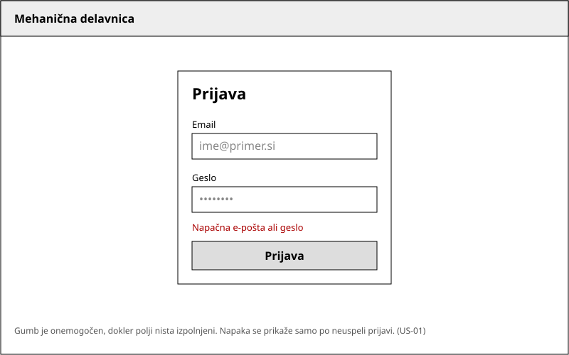
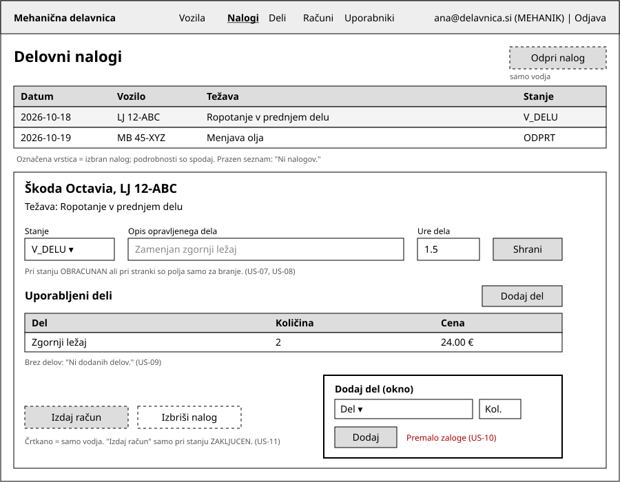
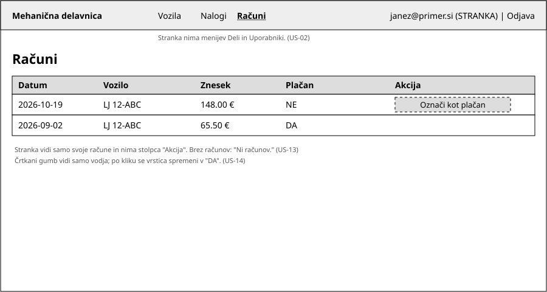

# 05 Wireframes

Skice so črno-beli SVG-ji v mapi `wireframes/`. Črtkani elementi so vidni samo vodji. Uporabniške zgodbe so v [05-uporabniske-zgodbe.md](05-uporabniske-zgodbe.md).

## 1. Prijava

Prijavna kartica z e-pošto, geslom in gumbom "Prijava". Gumb je onemogočen, dokler polji nista izpolnjeni, ob napačnih podatkih se prikaže rdeče sporočilo.
Zgodbe: US-01.

## 2. Delovni nalogi

Zgoraj meni, pod njim tabela nalogov, izbrani nalog pa se odpre spodaj. Mehanik in vodja spremenita stanje, vpišeta opis dela in ure ter prek okna dodata del; ob premajhni zalogi se v oknu prikaže napaka. Vodja ima še gumba "Odpri nalog" in "Izdaj račun" (samo pri stanju ZAKLJUCEN).
Zgodbe: US-06, US-07, US-08, US-09, US-10, US-11.

## 3. Računi

Seznam računov z datumom, vozilom, zneskom in oznako plačan. Stranka vidi samo svoje račune in nima menija Deli ali Uporabniki, vodja pa ima pri neplačanem računu gumb "Označi kot plačan".
Zgodbe: US-02, US-13, US-14.
